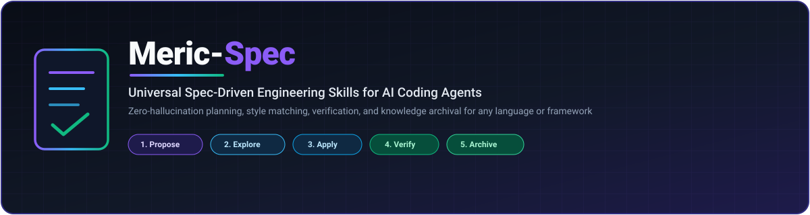

<div align="center">

<a href="#why-meric-spec">
  
</a>

<br />
<br />

[](https://github.com/masaner/meric-spec/actions/workflows/ci.yml)
[](https://www.skills.sh/masaner/meric-spec)
[](#why-meric-spec)
[](https://www.skills.sh/agent/antigravity)
[](LICENSE)

<br />

[](docs/how-to-use.md)

<br />

**Turn any AI coding agent into a disciplined, zero-hallucination engineering partner: Propose → Explore → Apply → Verify → Archive.**

[How-To Guide](docs/how-to-use.md) •
[Why Meric-Spec?](#why-meric-spec) •
[Workflow](#the-5-stage-workflow) •
[Install Skills](#quick-install) •
[Specs Layout](#specs-directory-structure) •
[Documentation](#documentation)

</div>

---

## Why Meric-Spec?

AI coding agents are fast—but without guardrails they skip clarifying questions, hallucinate nonexistent files, break your team's spacing and architectural conventions, and drop crucial design context once a chat finishes.

**Meric-Spec** solves this with **5 lightweight, stack-agnostic [skills.sh](https://skills.sh) skills** that work across **any codebase** (TypeScript, React, Astro, Python, Go, Rust, Java, Salesforce Apex/LWC, SQL, and DevOps):

* **Zero Hallucinations:** Stage 2 (`Explore`) inspects real files, configs, and connected environments before any code is modified.
* **Exact Style & Convention Fidelity:** Automatically detects indentation, spacing, newline style, formatter rules, sharing/auth models, and test runners so edits match your repo to the character.
* **Interactive Multi-Round Q&A + Auto-Advance:** Clarifies edge cases cleanly across multiple rounds, then transitions automatically (`continue` / `next` / `archive`) from one stage to the next.
* **Permanent Self-Contained Memory (`specs/archived/`):** Summarizes every verified specification into one clean archive document so future AI agent sessions inherit 100% of what was built and why.

---

## Quick Install

Install all 5 skills into **Antigravity** ([skills.sh/agent/antigravity](https://www.skills.sh/agent/antigravity)), Claude Code, Cursor, GitHub Copilot, Codex, or Gemini CLI:

```bash
# Project-scoped install (writes ./.agents/skills/)
npx skills add masaner/meric-spec

# Global Antigravity install (available across every workspace on your machine)
npx skills add masaner/meric-spec -g --agent antigravity --skill '*' -y

# Preview skills without installing
npx skills add masaner/meric-spec --list
```

> **New to Meric-Spec?** Read the **[Quick How-To Guide (`docs/how-to-use.md`)](docs/how-to-use.md)** for full CLI options, prompt examples, and workflow diagrams.

---

## The 5-Stage Workflow

```mermaid
flowchart LR
    U["User Intent"] --> S1["1. meric-spec-propose"]
    S1 -->|"01-proposal.md + Multi-Round Q&A"| S2["2. meric-spec-explore"]
    S2 -->|"Audit + Style Fingerprint -> 02-exploration.md"| S3["3. meric-spec-apply"]
    S3 -->|"Sequential 1-by-1 Edits -> 03-apply.md"| S4["4. meric-spec-verify"]
    S4 -->|"Traceability + Lint/Tests -> 04-verification.md"| Gate{"PASS?"}
    Gate -->|"Fix gaps"| S3
    Gate -->|"User confirms 'archive'"| S5["5. meric-spec-archive"]
    S5 -->|"Consolidated specs/archived/<session>.md"| Done["Clean Workspace & Future AI Know-How"]
```



| Stage | Skill | Responsibility & Auto-Handoff | Artifact Written |
| :--- | :--- | :--- | :--- |
| **1. Propose** | [`meric-spec-propose`](skills/meric-spec-propose/SKILL.md) | Listens to user intent, runs multi-round Q&A, updates requirements, and transitions to **Explore** on `continue`. | `specs/active/<session>/01-proposal.md` |
| **2. Explore** | [`meric-spec-explore`](skills/meric-spec-explore/SKILL.md) | Performs zero-hallucination audit + style/spacing/newline fingerprint, writes ordered checklist, and transitions to **Apply** on `continue`. | `specs/active/<session>/02-exploration.md` |
| **3. Apply** | [`meric-spec-apply`](skills/meric-spec-apply/SKILL.md) | Executes every checklist item 1-by-1 matching existing code conventions, logs exact outputs, and transitions to **Verify**. | `specs/active/<session>/03-apply.md` |
| **4. Verify** | [`meric-spec-verify`](skills/meric-spec-verify/SKILL.md) | Verifies every Proposal/Explore item against edited files and real lint/test runs, then prompts the user to archive. | `specs/active/<session>/04-verification.md` |
| **5. Archive** | [`meric-spec-archive`](skills/meric-spec-archive/SKILL.md) | Consolidates `01–04` into one permanent knowledge file for future AI agents, removes the active folder, and updates `specs/README.md`. | `specs/archived/<session>.md` |

---

## `specs/` Directory Structure

```text
specs/
├── README.md                                  # Master index of completed archived specs
├── active/                                    # In-progress work isolated by timestamp + subject
│   └── 2026-11-17-1430-auth-middleware/
│       ├── 01-proposal.md
│       ├── 02-exploration.md
│       ├── 03-apply.md
│       └── 04-verification.md
└── archived/                                  # Clean 1-file knowledge summaries for future agents
    └── 2026-11-17-1430-auth-middleware.md
```

---

## Documentation

| Guide | Purpose |
| :--- | :--- |
| [Quick How-To Guide (`docs/how-to-use.md`)](docs/how-to-use.md) | Step-by-step installation, Antigravity commands, and end-to-end prompt examples |
| [Skills Catalog (`skills/README.md`)](skills/README.md) | Index of all 5 `meric-spec-*` skills and `skills.sh.json` publishing rules |
| [Specs Reference (`specs/README.md`)](specs/README.md) | `specs/active/` vs. `specs/archived/` lifecycle and archive index template |

## License

Released under the [MIT License](LICENSE).
