# Quick How-To Guide: Adding & Using Meric-Spec Skills

[](https://www.skills.sh/masaner/meric-spec)

This guide explains how to install **Meric-Spec** in **30 seconds** and use its **5-Stage Spec-Driven Engineering Workflow (`Propose → Explore → Apply → Verify → Archive`)** across **any** codebase—TypeScript, React, Astro, Python, Go, Rust, Java, C#, Salesforce Apex, SQL, or infrastructure repositories.

* **Live skills.sh Catalog:** [skills.sh/masaner/meric-spec](https://www.skills.sh/masaner/meric-spec)
* **Antigravity Platform Directory:** [skills.sh/agent/antigravity](https://www.skills.sh/agent/antigravity)
* **Specs Directory Reference:** [`specs/README.md`](../specs/README.md)

---

## Step 1: Add Meric-Spec Skills to Your AI Agent

Run from inside any project folder (works with **Antigravity**, Claude Code, Cursor, GitHub Copilot, Codex, Gemini CLI, Windsurf, and other `skills.sh` agents):

```bash
# Install all 5 workflow skills at project scope (./.agents/skills/)
npx skills add masaner/meric-spec

# Recommended: Install globally for Antigravity across EVERY repository on your machine (~/.agents/skills/)
npx skills add masaner/meric-spec -g --agent antigravity --skill '*' -y

# Preview skills before installing
npx skills add masaner/meric-spec --list
```

### Managing Installed Skills

```bash
npx skills list -g --agent antigravity   # Confirm global Antigravity skills
npx skills update                        # Pull the latest Meric-Spec updates
npx skills remove meric-spec-propose     # Remove an individual skill if needed
```

> **Antigravity Tip:** After running `npx skills add masaner/meric-spec`, start a new Antigravity session so the agent loads the newly installed skills automatically.

---

## Step 2: How the 5-Stage Lifecycle Works (`specs/`)

When you ask your AI agent to plan and execute a feature, refactor, or bugfix with Meric-Spec, it manages all intermediate state inside a clean `specs/` folder in your project:

```mermaid
flowchart LR
    Intent["User Intent"] --> Propose["1. meric-spec-propose"]
    Propose -->|"Creates specs/active/<timestamp>-<slug>/01-proposal.md"| QA1["Multi-Round Clarifying Q&A"]
    QA1 -->|"User replies: continue / next"| Explore["2. meric-spec-explore"]
    Explore -->|"Zero-hallucination audit + style fingerprint -> 02-exploration.md"| QA2["Confirm Plan & Technical Q&A"]
    QA2 -->|"User replies: continue / next"| Apply["3. meric-spec-apply"]
    Apply -->|"Executes checklist 1-by-1 in codebase style -> 03-apply.md"| Verify["4. meric-spec-verify"]
    Verify -->|"Checks goals, style & test suite -> 04-verification.md"| Gate{"PASS?"}
    Gate -->|"Issues found"| Apply
    Gate -->|"User replies: archive / continue"| Archive["5. meric-spec-archive"]
    Archive -->|"Saves specs/archived/<session>.md & cleans active/"| Memory["Permanent Context for Future AI Agents"]
```



### Active vs. Archived `specs/` Layout

```text
your-project/
└── specs/
    ├── README.md                                  # Master index of archived specs
    ├── active/                                    # In-progress sessions (time-coded + subject slug)
    │   └── 2026-11-17-1430-rate-limiter-middleware/
    │       ├── 01-proposal.md                     # Intent, goals, boundaries & Q&A decisions
    │       ├── 02-exploration.md                  # Observed files/lines, style fingerprint & checklist
    │       ├── 03-apply.md                        # Sequential change log & raw command outputs
    │       └── 04-verification.md                 # Traceability matrix & lint/test proof
    └── archived/                                  # Clean single-file knowledge summaries
        └── 2026-11-17-1430-rate-limiter-middleware.md
```

### Why Teams & Solo Developers Love This Flow

1. **Multi-Round Q&A Before Coding (`01-proposal.md`):** The agent asks clarifying questions first and updates the proposal after each round instead of guessing requirements.
2. **Zero Hallucinations & Exact Style Matching (`02-exploration.md`):** Before editing anything, `meric-spec-explore` reads the actual repo, verifies every file path/symbol, and records indentation, spacing, newline conventions, formatter configs, error patterns, and test runners.
3. **Seamless `continue` Auto-Transitions:** Once you confirm a stage—simply type `continue` or `next`—the current skill updates status and immediately invokes the next skill automatically.
4. **Evidence-Based Verification (`04-verification.md`):** `meric-spec-verify` proves every Proposal goal and Exploration checklist item matches real modified files and observed lint/test runs before offering archiving.
5. **Single-File Project Memory (`specs/archived/`):** Running `archive` collapses all 4 temporary files into one crisp archive file and removes the active session folder, giving future AI sessions instant, exact know-how of what was built.

---

## Step 3: Copy-Paste Example Prompts

### Example A: TypeScript / Node.js API Feature
```text
You:   "Use meric-spec-propose to add Redis-backed rate limiting middleware to our Express API."
Agent: [Writes specs/active/<timestamp>-redis-rate-limiter/01-proposal.md & asks Q&A Round 1]
You:   "1. 100 req/min per API key. 2. Fail open if Redis is unreachable. continue"
Agent: [Runs meric-spec-explore -> audits middleware/, package.json, Prettier rules, Jest tests
        -> writes 02-exploration.md checklist]
You:   "continue"
Agent: [Runs meric-spec-apply 1-by-1 -> logs 03-apply.md -> auto-runs meric-spec-verify ->
        runs npm test & eslint -> writes 04-verification.md (PASS) -> prompts to archive]
You:   "archive"
Agent: [Runs meric-spec-archive -> creates specs/archived/<timestamp>-redis-rate-limiter.md,
        updates specs/README.md, deletes active session folder]
```

### Example B: Pairing with Domain Skills (e.g., `masaner/apex-guard`)
Install `masaner/meric-spec` globally once, then install project-specific skills per domain (like `npx skills add masaner/apex-guard`):
* **`meric-spec-*`** governs *how* the AI collaborates (`Propose → Explore → Apply → Verify → Archive`).
* **Domain skills** (such as `apex-guard-*`, `cloudflare`, etc.) supply framework-specific APIs and best practices inside **Explore**, **Apply**, and **Verify**.
